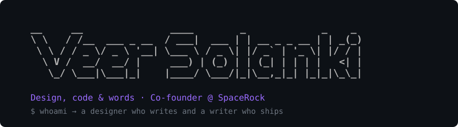

Veer Solanki is a designer and full-stack developer from Faridabad, India, who also writes about tech and society.
He co-founded [SpaceRock](https://spacerock.club), a student-run tech and science publication, writes on social and civic issues for
[Les Comrades](https://www.lescomrades.com/), and designs and builds websites and web apps end to end, from Figma to deploy.

## About Me
* I design it, build it, then write about it. I speak both Figma and git push.
* Co-founded **SpaceRock** in 2025 with a team of writers from my class. I designed the brand and built the whole site: headless WordPress, React, Vite and Vercel.
* Built **[Mirage](https://github.com/imveersolanki/Mirage)**, a sketch-to-layout frontend builder, with my team at the CodeStorm 2026 hackathon.
* Researching AI hallucination: how large language models respond to questions about things that don't exist, and when they make things up versus admit they don't know.
* Outside code: superheroes, video games, guitar and drawing.

## Projects
| Project | What it is | Links |
|---|---|---|
| **Mirage** | Draw a box, get a component. Sketch-to-code builder with 34 themes | [Live](https://mirageui.vercel.app/) · [Code](https://github.com/imveersolanki/Mirage) |
| **Ringer** | Multi timer: a looping interval bell and a plain countdown | [Live](https://ringtimer.vercel.app/) · [Code](https://github.com/imveersolanki/Ringtimer) |
| **Uchaan Arts** | Website redesign for a contemporary Indian art gallery | [Live](https://uchaanarts.vercel.app/) · [Code](https://github.com/imveersolanki/Uchaanarts) |
| **SiteDNA** | Open-source tool, MIT licensed | [Code](https://github.com/imveersolanki/SiteDNA) |
| **SpaceRock** | Tech and science publication, designed and built from scratch | [Live](https://spacerock.club) |

## Tech Stack
I work with: 

## Certifications
* Claude Academy: Claude Code 101 · Claude 101 · AI Fluency: Framework and Foundations (Anthropic)
* Content Marketing Certified (HubSpot Academy)

## Social Links

[<picture><source media='(prefers-color-scheme: dark)' srcset='https://api.iconify.design/simple-icons/github.svg?color=white&height=40'><source media='(prefers-color-scheme: light)' srcset='https://api.iconify.design/simple-icons/github.svg?color=black&height=40'></picture>](https://github.com/imveersolanki)&nbsp; &nbsp;[<picture><source media='(prefers-color-scheme: dark)' srcset='https://api.iconify.design/mdi/web.svg?color=white&height=40'><source media='(prefers-color-scheme: light)' srcset='https://api.iconify.design/mdi/web.svg?color=black&height=40'></picture>](https://veersolanki.in)&nbsp; &nbsp;[<picture><source media='(prefers-color-scheme: dark)' srcset='https://api.iconify.design/mdi/linkedin.svg?color=white&height=40'><source media='(prefers-color-scheme: light)' srcset='https://api.iconify.design/mdi/linkedin.svg?color=black&height=40'></picture>](https://www.linkedin.com/in/veer-solanki/)&nbsp; &nbsp;[<picture><source media='(prefers-color-scheme: dark)' srcset='https://api.iconify.design/simple-icons/gmail.svg?color=white&height=40'><source media='(prefers-color-scheme: light)' srcset='https://api.iconify.design/simple-icons/gmail.svg?color=black&height=40'></picture>](mailto:veersolanki1738@gmail.com)&nbsp; &nbsp;[<picture><source media='(prefers-color-scheme: dark)' srcset='https://api.iconify.design/simple-icons/icloud.svg?color=white&height=40'><source media='(prefers-color-scheme: light)' srcset='https://api.iconify.design/simple-icons/icloud.svg?color=black&height=40'></picture>](https://Veersolanki.in)

## Software I use

## Articles I've Written
<!--START_SECTION:spacerock-->
<!--END_SECTION:spacerock-->
